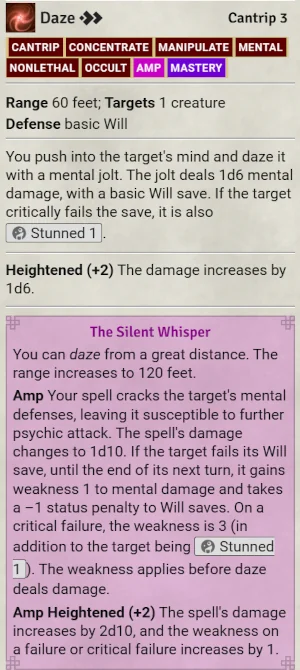

# Outrider's Cantrips

Suite of RAW-compatible Quality of Life modifications for Pathfinder 2 (PF2e) and Starfinder 2
(SF2e) Cantrips and cantrip-like abilities, with a growing set of *optional* Homebrew house
rules. All for use within [Foundry VTT](https://foundryvtt.com/), part of the
[Outrider's Pathfinder Tools](https://0utrider.github.io/pathfinder/) collection.

All settings live in **Configure Settings -> Outrider's Cantrips**, grouped by category.

## Quality of Life

**Enabled by default.** These follow Rules as Written (RAW).
Class-specific options only show in their respective game system's Settings.

## Homebrew

**Off by default.** Turn on only what you want at the table. Works on PF2e and SF2e.

## Contents

- Four compendiums: Feats (PF2e), Feats (SF2e), Macros (PF2e), Spells (PF2e).
- Compendium content and the module's macros both sit in the shared "Outrider's Mods" folder
  alongside every other Outrider module - macros are also synced into the Macros sidebar tab
  directly, not just reachable by browsing the compendium.

## Features

### Quality of Life

| Feature | Default | What it does |
|---|---|---|
| Psychic Amps | on | A per-cast "Amp?" prompt for the Psychic class's psi cantrips, covering all six Conscious Minds, plus the amp effects the system only describes in text (Daze, Forbidden Thought, Shatter Mind, Telekinetic Rend, Phase Bolt, Ghostly Shift, Guidance, Contagious Idea, Frostbite, and Telekinetic Hand's Shove and Disarm rolled as a real spell attack). |
| Encore | on | A per-cast prompt for the Bard's composition spellshapes, Lingering Composition and Fortissimo Composition, with the Performance check rolled automatically and the result applied. |
| Familiar's Echo | on | A per-cast prompt for the Witch's patron familiar ability on a Cast or Sustained hex, plus a Sustain button on the hex's own chat card. |
| Kineticist shortcuts | n/a | Two macros, Toggle Elemental Blast and Cycle Elemental Blast Damage, reproducing controls already on the sheet. No setting, since there is nothing to turn off. |

Each feature's chat cards get a small colored callout and tag, in a palette chosen per feature
(six fixed options, plus a "Player Color" choice that matches the caster's own chat color).

### Homebrew

| Feature | Default | What it does |
|---|---|---|
| Cantrip Mastery | off | A feat (Feats compendium) that adds a +1 untyped bonus to cantrip attack rolls and DCs, plus the caster's spellcasting attribute modifier to a cantrip's damage, healing, or temporary Hit Points. |
| Stabilize also heals | on (sub-option) | With Cantrip Mastery on, casting Stabilize also heals the target by the same modifier. Needs an active GM connected. |
| Cantrip Mastery for Elemental Blast | off | PF2e only. With Cantrip Mastery also on, a character with the feat gains a +1 untyped bonus to Elemental Blast's attack and damage rolls. |
| Spellcasting Modifier | off | The same damage/healing boost as Cantrip Mastery's core benefit, table-wide, with no feat required. |

## Roadmap

SF2e-native Quality of Life automation is being scoped for 1.1.0: Technomancer's Overclock Gear
and Jailbreak Spell, and Witchwarper's Spellsurge Ammo, are the current candidates. PF2e's Bard,
Psychic, Witch, and Kineticist have no SF2e equivalent, so this is new automation built for
Starfinder's own classes, not a port.

## License

GPL-3.0-or-later. See `LICENSE`.
